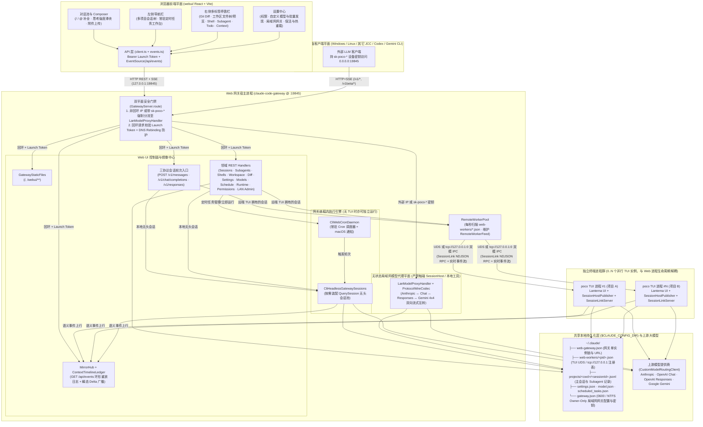
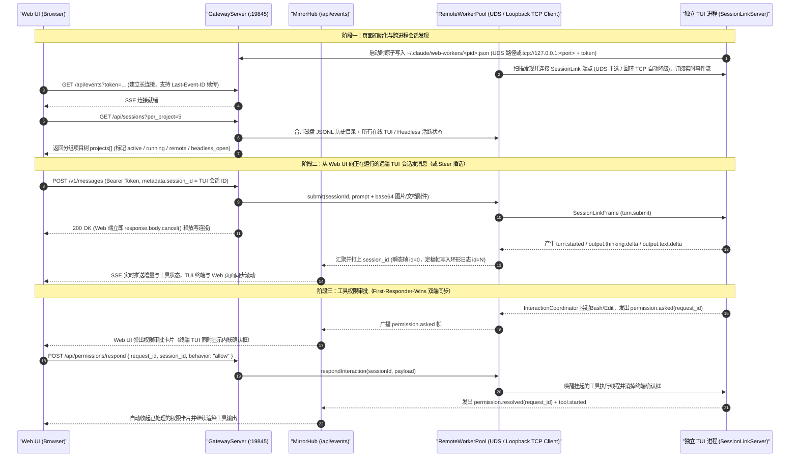

# Web UI & TUI 解耦架构与前后端交互 API 全景指南

本文档梳理近期将 `webui/`（前端工程）、`claude-code-gateway`（嵌入式 HTTP+SSE 网关）与 `claude-code-ui`（Lanterna 终端 TUI）彻底解耦后的**模块边界、多进程拓扑、跨进程 IPC 机制，以及前后端全量 HTTP/SSE 交互协议**。

完整的机器可读接口定义同步维护于仓库根目录的 [openapi.yaml](../openapi.yaml)。

---

## 1. 解耦设计核心原则

解耦分**编译期模块隔离**与**运行期进程独立**两个层面落地：

1. **编译期零耦合（Port/Adapter 边界）**：
   - `webui/` 是独立的 React + TypeScript + Vite 单页应用，构建产物作为静态资源打包进 `claude-code-app`，与 Java 终端渲染代码无任何交叉。
   - `claude-code-gateway` 仅依赖 `core`、`runtime`、`api`、`session`，**不依赖 `claude-code-ui`（Lanterna）、`claude-code-tools` 或 `claude-code-services`**。所有宿主能力均通过 `Gateway*Port` 窄接口注入，由 `claude-code-cli` 组合根负责装配。
2. **运行期单实例网关 + 多进程 Worker 拓扑**：
   - **单实例常驻网关（`poco web` / `poco web -d`）**：独占本机固定端口 `19845`（测试可通过 `CLAUDE_WEB_PORT` 覆盖），在 `$CLAUDE_CONFIG_DIR/web-gateway.json` 发布发现记录与一次性启动 Token。即使本机**未打开任何 TUI 终端**，Web UI 也可独立完成新建/恢复无头会话（`CliHeadlessGatewaySessions`）、执行常驻定时任务（`CliWebCronDaemon`）以及充当局域网多协议模型网关（`LanModelProxyHandler`）。
   - **任意数量的独立 TUI 进程**：每个交互式 TUI 启动时通过 `SessionLinkServer.Config.adaptive(...)` 自适应建立本地 IPC 端点——优先绑定私有 Unix Domain Socket（macOS / Linux / 现代 Windows `afunix.sys`），当 Windows 路径超过 100 字节上限或缺失 `afunix.sys` 时自动无缝降级为仅回环 `tcp://127.0.0.1:0` 随机端口，并通过 `OwnerOnlyPermissions`（Unix `0600`/`0700` 或 Windows NTFS 单用户 Owner DACL）将端点与一次性密钥原子注册至 `$CLAUDE_CONFIG_DIR/web-workers/<pid>.json`。网关内的 `RemoteWorkerPool` 每秒扫描该目录并维护长连接，TUI 可随时独立启停而不断开浏览器页面。
3. **前后端读写分离（Command / Mirror Split）**：
   - **写链路（Command）**：前端提交对话轮次时调用 `POST /v1/messages`（携带 `metadata.session_id`），网关受理入队后前端立即关闭该次 POST 响应体，不在 POST 流上做 UI 渲染。
   - **读链路（Query / Mirror）**：前端通过单条全局长连接 `GET /api/events?token=...`（`MirrorHub`）统一接收本机所有活跃 TUI 会话与已打开无头会话的实时流式增量、工具生命周期、权限审批卡片及会话变更通知，并利用环形缓冲区（Ring Journal）与 `Last-Event-ID` 实现断线无损续传。

---

## 2. 全局系统架构图

---

## 3. 核心交互时序：读写分离、跨进程 TUI 转发与双端权限抢答

---

## 4. 前后端全量交互 API 参考手册

### 4.1 鉴权模型与双平面安全隔离

网关在同一个监听端口上严格划分两个互不穿透的安全平面：

| 访问平面 | 触发条件 | 鉴权方式 | 允许访问的路由范围 |
| :--- | :--- | :--- | :--- |
| **Web UI 管理与会话平面** | 源地址为本机直连回环（`127.0.0.1` / `::1`，且无代理转发头）且未携带 `sk-poco-*` 密钥 | `Authorization: Bearer <launch-token>`（SSE 订阅允许 `?token=<launch-token>`），配合 `Host` 头 DNS Rebinding 校验 | `/api/**`、静态页面 `/` & `/webui/**`、以及驱动本地/TUI 会话的 `POST /v1/{messages,chat/completions,responses}` |
| **局域网无状态模型代理平面** | 源地址非本机回环，**或**任意请求头/参数携带 `sk-poco-*` 密钥 | `Authorization: Bearer sk-poco-*`、`x-api-key: sk-poco-*`、`x-goog-api-key: sk-poco-*` 或 `?key=sk-poco-*`（外加可选 CIDR 白名单与 Key 级模型白名单） | **仅限无状态 LLM 转发路由**（`/v1`、`/v1/models`、`/v1beta/models`、`/v1/messages`、`/v1/chat/completions`、`/v1/responses`、`/v1beta/models/{m}:*`）；访问任何 `/api/**` 或 `/webui/**` 一律返回 `403 Forbidden`，且绝不触发宿主 `SessionHost` 或本地工具 |

---

### 4.2 实时事件流接口（SSE 读链路）

| 方法与路径 | 用途 | 核心机制与事件帧类型 |
| :--- | :--- | :--- |
| `GET /api/events?token=<token>` | 全局会话实时镜像流（`MirrorHub`） | • **带单调递增 `id` 的可重放日志帧**（断线重连通过 `Last-Event-ID` 自动补齐）：   `turn.started`、`output.text`、`output.thinking`、`tool.started`、`tool.progress`、`tool.completed`、`permission.asked`、`permission.resolved`、`sudo.asked`、`sudo.resolved`、`permission.mode`、`session.activated`、`session.error`、`session.idle`、`turn.cancelled`、`turn.completed`、`task_board` • **无游标瞬态帧（`id = 0`，仅实时推送不入环）**：   `output.text.delta`、`output.thinking.delta`、`sessions.changed`（当后台有 TUI 进程新启动或退出时通知侧边栏刷新目录） |

---

### 4.3 对话轮次提交与中断接口（写链路）

| 方法与路径 | 前端调用函数 | 说明 |
| :--- | :--- | :--- |
| `POST /v1/messages` | `submitTurn(sessionId, content)` | Web UI 主用发消息入口。`metadata.session_id` 缺省时投递给当前活跃 TUI 会话，指定时投递给对应远端 TUI 或已打开的 Headless 会话；`content` 支持纯文本或含 Base64 图片/PDF 文档的内容块数组。若目标会话正忙，支持根据设置执行排队（Queue）或插话引导（Steer）。 |
| `POST /v1/chat/completions` `POST /v1/responses` | 外部本地集成可用 | 同样挂载在会话网关平面（持 Launch Token 时），支持用标准 OpenAI Chat / Responses 协议驱动本地会话轮次。 |
| `POST /api/session/cancel` | `cancelTurn({ session_id })` | 中断目标会话正在执行的轮次（等价于在终端按下 `Ctrl+C` 的 `user-cancel`）。 |

---

### 4.4 会话目录、历史快照、生命周期与子代理（Sub-agent）API

| 方法与路径 | 前端调用函数 | 说明 |
| :--- | :--- | :--- |
| `GET /api/sessions?per_project=<n>` | `fetchCatalog(perPage)` | 返回按工作目录聚合的二级项目→会话树（融合磁盘 JSONL 历史、进程内 Headless 会话与所有跨进程在线 TUI 会话的实时运行态）。 |
| `POST /api/sessions/open` | `openHeadlessSession(sessionId, projectPath)` | 在网关进程内打开或新建一个无头 `QuerySession`（`session_id` 为空则在该项目路径下新建会话）。 |
| `POST /api/sessions/close` | `closeHeadlessSession(sessionId)` | 关闭并释放网关进程内指定的无头会话实例（不删除磁盘记录）。 |
| `GET /api/sessions/{id}/messages` | `fetchSnapshot(sessionId)` | 读取指定会话的完整历史消息快照（若当前正在流式输出中，一并附带未定稿的 `streamingDraft` 与运行起始时间戳）。 |
| `POST /api/sessions/{id}/rename` | `renameSession(id, title)` | 原地重命名会话标题（追加写入 JSONL 元数据）。 |
| `POST /api/sessions/{id}/fork` | `forkSession(id, title?)` | 从已完成轮次分叉（Fork）出一条新会话。 |
| `POST /api/sessions/{id}/archive` | `archiveSession(id)` | 归档隐藏会话。 |
| `DELETE /api/sessions/{id}` | `deleteSession(id)` | 永久删除会话主 JSONL 及其附属 sidecar 目录。 |
| `GET /api/sessions/{id}/agents/{agentId}/transcript` | `fetchAgentTranscript(id, agentId)` | 读取某个子代理（Sub-agent）独立的 sidechain 对话记录快照。 |
| `POST /api/sessions/{id}/agents/{agentId}/prompt` | `promptAgent(id, agentId, prompt)` | 向运行中或已完成的子代理继续追加指令（排队注入或从 sidechain 唤醒续跑）。 |
| `POST /api/sessions/{id}/agents/{agentId}/stop` | `stopAgent(id, agentId)` | 单独停止指定的运行中子代理。 |

---

### 4.5 单会话上下文、模型/思考强度、权限模式与交互裁决 API

| 方法与路径 | 前端调用函数 | 说明 |
| :--- | :--- | :--- |
| `GET /api/session/context?session_id=` | `fetchSessionContext(sessionId)` | 获取目标会话当前选中的模型、可选模型列表、思考强度档位（`effort`）以及上下文 Token 占用统计。 |
| `POST /api/session/context` | `selectSessionContext({ session_id, model?, effort? })` | 实时切换目标会话的模型或思考强度（若该会话属于远端 TUI，通过 Unix Socket 同步更新 TUI 底栏状态）。 |
| `GET /api/session/context/timeline` `GET /api/session/context/detail` `GET /api/session/context/content` `GET /api/session/context/overview` | `fetchContextTimeline` `fetchContextDetail` `fetchContextContent` `fetchContextOverview` | 供右侧栏 / 设置中的 Context 可视化面板按轮次钻取系统提示词、工具 Schema 定义、单步消息负载与多会话上下文总览。 |
| `GET /api/session/permission-mode?session_id=` | `fetchPermissionMode(sessionId)` | 读取目标会话当前的权限模式（`default` / `plan` / `acceptEdits` / `auto` / `dontAsk` / `bypassPermissions`）及可选项。 |
| `POST /api/session/permission-mode` | `selectPermissionMode({ session_id, mode })` | 实时切换目标会话权限模式，并通过 `permission.mode` 帧广播给所有终端与浏览器标签页。 |
| `GET /api/session/tasks?session_id=` | `fetchSessionTasks(sessionId)` | 冷启动加载目标会话的 Todo 任务看板（运行期增量通过 `task_board` SSE 帧同步）。 |
| `POST /api/permissions/respond` | `respondPermission(request)` | 审批工具权限请求或回答 `AskUserQuestion` 多选/单选/自由输入卡片（按 `request_id` 幂等消卡）。 |
| `POST /api/sudo/respond` | `respondSudo(request)` | 提交或拒绝本地 `sudo` 密码交互请求。 |

---

### 4.6 工作区文件、Git 变更对比、后台 Shell 与输入补全 API

| 方法与路径 | 前端调用函数 | 说明 |
| :--- | :--- | :--- |
| `GET /api/workspace-tree?session_id=&path=` | `fetchWorkspaceTree(sessionId, dir)` | 右侧停靠栏「文件」标签页按需展开会话所属工作区目录的直接子项。 |
| `GET /api/workspace-file?session_id=&path=` | `fetchWorkspaceFile(sessionId, path)` | 预览工作区文件内容（自动识别文本、二进制或超大文件，严格限制在会话工作区根目录内防路径穿越）。 |
| `GET /api/changes.summary?session_id=` `GET /api/changes.diff?session_id=&path=` | `readAuthorized(...)`（`HostReadStore`） | 右侧停靠栏「变更」标签页读取会话工作区的 Git 改动文件摘要与逐文件 Diff。 |
| `GET /api/shells` `GET /api/shells/{taskId}` `POST /api/shells/{taskId}/stop` | `fetchShells()` `fetchShellOutput(taskId)` `stopShell(taskId)` | 列出后台运行的 Bash Shell 任务、查看实时截取的标准输出/退出码，以及终止后台进程。 |
| `GET /api/commands` | `fetchComposerCommands()` | 获取输入框 `/` 菜单与 `+` 菜单的斜杠命令目录（含全局 `~/.claude/skills` 与项目级 `.claude/skills` 技能）。 |
| `GET /api/file-suggestions?q=<query>` | `fetchFileSuggestions(query)` | 获取输入框 `@` 文件路径补全候选（复用 TUI 同款模糊打分排序器）。 |
| `GET /api/spinner-verbs` | `fetchSpinnerVerbs()` | 获取运行状态行的动态动词词库，保持 Web UI 与 TUI 视觉反馈一致。 |

---

### 4.7 全局设置、自定义模型、常驻定时任务与局域网模型网关 API

| 领域 | 方法与路径 | 前端调用函数 | 说明 |
| :--- | :--- | :--- | :--- |
| **多层级设置** | `GET /api/settings` `POST /api/settings` | `fetchSettingsSnapshot()` `writeUserSettingValue` / `writePermissionMode` / `replacePermissionRules` / `addAdditionalDirectories` / `removeAdditionalDirectories` | 读取带 `user` / `project` / `local` 来源归属的合并配置快照；按 `op` 写入配置并返回刷新后的完整快照。 |
| **自定义模型目录** | `GET /api/models` `POST /api/models` `DELETE /api/models/{name}` `POST /api/models/discover` `POST /api/models/batch` | `fetchCustomModels()` `saveCustomModel(...)` `removeCustomModel(name)` `discoverProviderModels(...)` `batchSaveCustomModels(...)` | 管理 `$CLAUDE_CONFIG_DIR/model.json`（支持 `anthropic` / `chat` / `responses` / `gemini` 四种协议），并支持服务端探测提供商 `/v1/models` 或 `/v1beta/models` 一键批量勾选导入。 |
| **常驻定时任务** | `GET /api/schedule` `POST /api/schedule` `PUT /api/schedule/{id}` `PATCH /api/schedule/{id}` `DELETE /api/schedule/{id}` `POST /api/schedule/{id}/run` | `fetchScheduleTasks()` `addScheduleTask(...)` `updateScheduleTask(...)` `toggleScheduleTask(id, enabled)` `removeScheduleTask(id)` `runScheduleTask(id)` | 读写 `$CLAUDE_CONFIG_DIR/scheduled_tasks.json`，支持配置 Cron、独立工作目录、每次新建/复用会话、单任务模型与思考强度覆盖、成功自动归档及立即手动触发。 |
| **运行时控制** | `GET /api/runtime/keepalive` `POST /api/runtime/keepalive` `POST /api/runtime/restart` | `fetchKeepaliveState()` `setKeepaliveEnabled(enabled)` `restartGatewayRuntime()` | 控制宿主系统级防休眠保活，以及不断开当前浏览器连接原地热重载配置、模型目录与定时任务。 |
| **CC Connector 外部协作** | `GET /api/cc-connect` `POST /api/cc-connect/attach` `POST /api/cc-connect/detach` `GET /api/cc-connect/logs` `POST /api/cc-connect/setup` `POST /api/cc-connect/setup/cancel` | `fetchCcConnectStatus()` `attachCcConnect(...)` `detachCcConnect(...)` `fetchCcConnectLogs(pid)` `runCcConnectSetup(...)` `cancelCcConnectSetup()` | 在 Web 守护进程内按在线 TUI PID 统一托管 `cc-connect`（飞书/IM 外部协作 sidecar），支持在 Web UI 选定监听目标、查看日志与飞书配置向导；TUI 底栏开启外部协作亦通过此链路自动拉起并上报 Web 守护进程（状态通过 `cc_connect.changed` SSE 实时双向同步）。 |
| **局域网网关管理面** | `GET /api/lan-gateway` `POST /api/lan-gateway` `POST /api/lan-gateway/keys` `POST\|PATCH\|DELETE /api/lan-gateway/keys/{id}` `GET\|DELETE /api/lan-gateway/calls` | `fetchLanGatewayStatus()` `updateLanGatewaySettings(...)` `createLanGatewayKey(...)` `updateLanGatewayKey(...)` `deleteLanGatewayKey(id)` `fetchLanGatewayCalls()` / `clearLanGatewayCalls()` | 在线热切换 `127.0.0.1:19845 ↔ 0.0.0.0:19845`、自动识别物理网卡/mDNS/Tailscale 地址（过滤 Clash `198.18.0.0/15` 虚拟网卡）、管理 `sk-poco-*` 设备密钥与模型白名单、查看最近代理调用遥测（TTFT、耗时、Token、协议转换方向）。 |
| **局域网网关数据面** | `GET /v1` · `GET /v1/models` · `GET /v1/models/{id}` · `GET /v1beta/models` `POST /v1/messages` · `POST /v1/messages/count_tokens` `POST /v1/chat/completions` · `POST /v1/responses` `POST /v1beta/models/{m}:generateContent` `POST /v1beta/models/{m}:streamGenerateContent` `POST /v1beta/models/{m}:countTokens` | 供局域网其它机器的 Claude Code / JCC / Codex / OpenAI SDK / Gemini CLI 调用 | 持 `sk-poco-*` 密钥进入无状态跨协议流式转发平面，支持 `4 × 4` 全协议互转、Claude 家族档位替身映射（Tier Stand-in）以及 `X-Poco-Gateway-Hop` 自环检测（`508 Loop Detected`）。 |

---

## 5. 网关对「远端 TUI 会话 vs 本地无头/历史会话」的路由分流矩阵

由于 Web 工程与 TUI 工程已解耦为独立进程，当 Web UI 操作任意 `session_id` 时，`GatewayServer` 按下表自动决定走**跨进程 Unix Socket 转发（`RemoteWorkerPool`）**还是**网关本地处理**：

| 操作类型 | 当 `session_id` 属于某个正在运行的外部 TUI 进程时 | 当 `session_id` 属于网关无头会话或冷历史记录时 |
| :--- | :--- | :--- |
| **提交消息 / Steer（`POST /v1/messages`）** | 经 Unix Domain Socket `SessionLink` RPC 投递给该 TUI 进程执行 | 投递给网关进程内 `CliHeadlessGatewaySessions`（若尚未打开可先 `open`） |
| **实时流式输出与工具事件（`GET /api/events`）** | `RemoteWorkerFeed` 订阅该 TUI 的 `SessionLink` 事件流并汇聚进 `MirrorHub` | 本地 `SessionEventHub` 直接推入 `MirrorHub` |
| **中断轮次（`POST /api/session/cancel`）** | 经 Unix Socket 触发该 TUI 会话的 `cancelTurn` | 调用本地无头 `QuerySession` 的取消控制器 |
| **读写模型 / 思考强度 / 权限模式** | 经 Unix Socket 实时读写该 TUI 内存态（终端底栏即时同步变化） | 读写网关进程内会话状态或回退至持久化设置 |
| **权限卡片 / AskUserQuestion 应答** | 经 Unix Socket `respondInteraction` 唤醒该 TUI 内挂起的 `InteractionCoordinator` | 唤醒网关进程内的 `InteractionCoordinator` |
| **历史快照 / 重命名 / Fork / 归档 / 删除** | 网关直接读写共享的 `~/.claude/projects/<cwd>/<id>.jsonl`（带文件锁安全序列化） | 网关直接读写共享的 `~/.claude/projects/<cwd>/<id>.jsonl` |
| **工作区文件树 / 文件预览 / Git Diff** | `RemoteWorkspaceFilePort` 解析该 TUI 注册的工作目录（`workDir`）后受限读取 | 按本地会话记录的 `cwd` 受限读取 |
